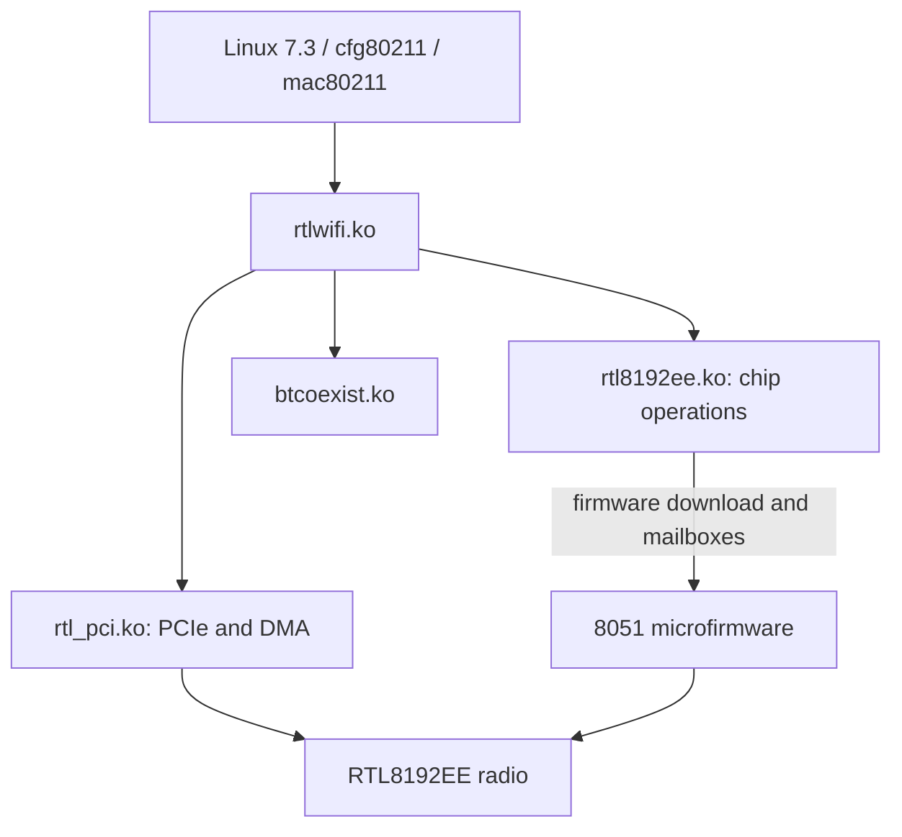

# HGW500 Realtek host driver for Linux 7.3

> Public source snapshot. [Scope, provenance and verification](docs/PUBLIC_SNAPSHOT.md).

This is the maintained Linux-side port for the 2.4 GHz RTL8192EE radio. The work covers PCIe/DMA, receive and transmit handling, firmware messaging and integration with the Linux wireless stack. The original 5.10 reconstruction and the 8051 payload analysis are maintained separately.

## How this component fits



This diagram shows software ownership and analysis flow, not a complete board schematic.
The [system architecture](docs/SYSTEM_ARCHITECTURE.md) explains the ARC750 host,
MuC, AuC, DSP and Realtek 8051, with their memory and firmware boundaries.

## What is established

| Area | Recorded scope |
| --- | --- |
| Working branch | port/linux-7.3; historical 5.10 results stay in their own branch/repository. |
| Integration source | src/combined-memory-rx-20261105/ is the documented R9/R11/DMA-completion source selection. It is not interchangeable with every experimental candidate. |
| Evidence model | Source fixtures, paired ARC builds and per-image client/traffic receipts are separate records. |
| Installed reference | The integration records API v2 R3 acceptance on 8 November. Earlier component README checkpoints describe older images and remain historical. |

## Start reading here

1. [Component handoff](docs/PROJECT_HANDOFF.md): inputs, evidence and next work.
2. [System architecture](docs/SYSTEM_ARCHITECTURE.md): processors and firmware families.
3. [Firmware contents](docs/FIRMWARE_MAP.md): OEM, Core Boot R1 and API v2 R3.
4. [Repository map](docs/REPOSITORY_MAP.md): host drivers, payloads and integration.
5. [Published checkout availability](docs/CHECKOUT_AVAILABILITY.md): actual remote source inventory.
6. [Preserved technical notes](docs/REFERENCE_NOTES.md): detailed earlier results, with workstation paths normalized.

## Work in progress

Continue candidate-specific receive/transmit, error-path and DMA qualification against the exact kernel ABI. Long-duration radio/load behavior remains a separate gate. Do not attribute results of one candidate or toolchain to another.

## Offline verification


```sh
python tools/verify_public_export.py
```

This checks the published file inventory. Original preservation verifiers and
receipts describe the private source checkpoint; they can require omitted native
databases or external inputs and are not a fresh public-snapshot qualification.

## Preservation and scope

This is a public source snapshot; per-unit data and original private histories remain private. Original vendor/GPL source, notices, comments,
carriers and immutable evidence retain their authorship and provenance. Derived
C is labelled as inferred analysis, not silently presented as original source.
Credentials, unit identity, calibration, personalized rootfs/flash images and
workstation-specific configuration stay outside documentation exports.

Documentation prepared 2026-11-10 from recorded source/evidence. No device access,
firmware installation, radio change or new physical qualification is implied.
